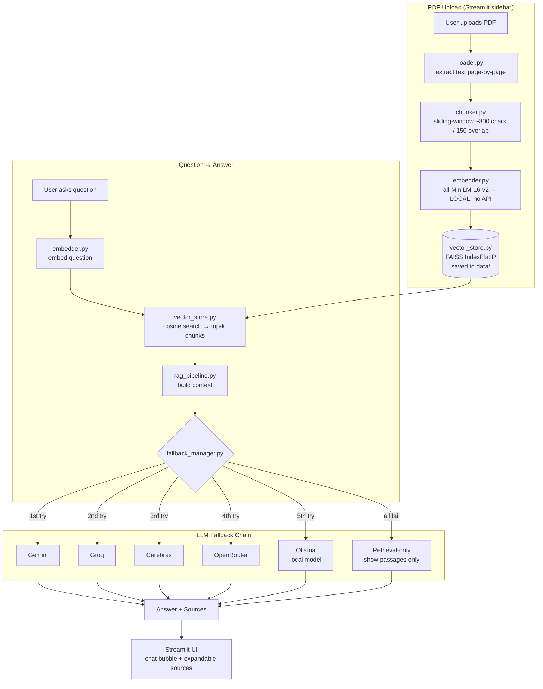

# 📚 AI Study Assistant

A **RAG (Retrieval-Augmented Generation)** chatbot that lets you upload PDFs — class notes, textbooks, research papers — and ask questions grounded **only** in those documents. Answers always cite the source file and page number.

Works **fully offline** (with a local Ollama model) or **online** (with free API keys from Gemini, Groq, Cerebras, or OpenRouter). Multiple providers fall back to each other automatically, so the app keeps working even when a free-tier limit is hit.

---

## ✨ Features

- 📄 **Upload multiple PDFs** — text is extracted page-by-page
- 🔍 **Semantic search** — cosine similarity via FAISS (always local)
- 🤖 **Multi-provider LLM with automatic fallback** — Gemini → Groq → Cerebras → OpenRouter → Ollama → retrieval-only
- 💾 **Persistent index** — no re-embedding after a restart
- 🔒 **Offline mode** — Ollama toggle sends nothing over the internet
- 🔑 **Bring-your-own-key** — enter API keys per session (never stored on disk)
- 📎 **Source citations** — file name, page number, similarity score, snippet
- 📡 **Provider status panel** — see which providers are ready, missing keys, or rate-limited

---

## 🏗️ Architecture



### How RAG works (in plain words)

1. **Upload** — Your PDF is split into ~800-character chunks. Each chunk is turned into a 384-number vector (its "meaning fingerprint") by a local AI model.
2. **Store** — All vectors are saved in a FAISS index on your disk. This is fast to search and persists between sessions.
3. **Ask** — Your question is also turned into a vector. FAISS finds the chunks whose vectors are closest to the question vector (cosine similarity).
4. **Generate** — The top-k matching chunks are sent to an LLM with the instruction: *"Answer only from this context."* The LLM writes the answer; it cannot make up information not in your documents.
5. **Cite** — The source file, page number, and similarity score are shown below every answer.

---

## 🚀 Setup

### Prerequisites

- Python 3.10+
- Git

---

### Mode A — Fully Offline with Ollama

Everything runs on your machine. Nothing is sent over the internet.

**1. Install Ollama**

```
https://ollama.com/download
```

**2. Pull a small model** (~2 GB, fits in 4 GB VRAM)

```bash
ollama pull llama3.2:3b
```

> 💡 On 16 GB RAM you can also run larger models like `ollama pull llama3.1:8b` — answers are better but generation is slower (~30 s per response on CPU).

**3. Clone and install the project**

```powershell
# Windows PowerShell
git clone <your-repo-url>
cd ai-study-assistant
python -m venv .venv
.venv\Scripts\Activate.ps1
pip install -r requirements.txt
```

```bash
# macOS / Linux
git clone <your-repo-url>
cd ai-study-assistant
python3 -m venv .venv
source .venv/bin/activate
pip install -r requirements.txt
```

**4. Configure**

```bash
cp .env.example .env   # macOS/Linux
# or: Copy-Item .env.example .env   (PowerShell)
```

Leave all API keys blank in `.env` — Ollama doesn't need one.

**5. Start Ollama (in a separate terminal)**

```bash
ollama serve
```

**6. Run the app**

```bash
streamlit run app.py
```

**7. In the app** — turn on the **"Offline mode (Ollama only)"** toggle in the sidebar.

---

### Mode B — Online with Free API Keys

**1. Get free API keys** (no credit card required for any of these)

| Provider | Where to get a key | Free model |
|----------|-------------------|------------|
| **Gemini** | https://aistudio.google.com/app/apikey | `gemini-2.0-flash-lite` |
| **Groq** | https://console.groq.com/keys | `llama-3.1-8b-instant` |
| **Cerebras** | https://cloud.cerebras.ai | `llama3.1-8b` |
| **OpenRouter** | https://openrouter.ai/keys | `meta-llama/llama-3.2-3b-instruct:free` |

> ⚠️ Free model names change often. Check each provider's docs if you get a "model not found" error.

**2. Clone and install** (same as Mode A steps 3–4)

**3. Add your keys to `.env`**

```env
GEMINI_API_KEY=your_key_here
GROQ_API_KEY=your_key_here
# etc.
```

**4. Run**

```bash
streamlit run app.py
```

The app will try providers in the order: Gemini → Groq → Cerebras → OpenRouter → Ollama (if running).

---

## 🧪 Running Tests

```powershell
# Windows
.venv\Scripts\pytest tests/ -v

# macOS / Linux
pytest tests/ -v
```

Expected output: all tests pass. The embedder tests require an internet connection on first run (to download the model, ~90 MB). After that, the model is cached locally.

---

## 🔐 Security & Privacy

- **Never commit `.env`** — it is listed in `.gitignore`.  Only `.env.example` (which contains no real keys) is committed.
- **Offline mode (Ollama)**: nothing leaves your machine. Embeddings and retrieval always run locally regardless of mode.
- **Online mode**: only your question + the retrieved text chunks (not the whole PDF) are sent to the chosen provider.
- **Bring-your-own-key**: keys typed in the sidebar are stored only in browser session memory (`st.session_state`) — never written to disk, never logged.
- **Hosted deployment** (e.g. Streamlit Community Cloud): Ollama cannot run on cloud hosts — it is automatically skipped. Visitors should enter their own keys in the sidebar so they do not drain the app owner's free limits.
- Always check each provider's data-use policy before uploading sensitive documents to an online provider.

---

## ⚠️ Limitations

- **No OCR**: scanned PDFs (image-only) produce no extractable text. Use PDFs with a text layer.
- **Free-tier limits change**: model names and rate limits are updated by providers frequently. Check `.env.example` for the current recommended models.
- **Context window**: very long documents produce many chunks; only the top-k most relevant ones are sent to the LLM. Information in other chunks won't be seen by the model for a given question.
- **Hallucination**: the prompt instructs the LLM to stay grounded, but LLMs can still occasionally generate plausible-sounding information. Always verify important answers against the source.

---

## 🔭 Future Improvements

- OCR support (e.g. `pytesseract`) for scanned PDFs
- Multi-turn conversation context (send previous Q&A pairs to the LLM)
- Hybrid search (BM25 + semantic) for better retrieval on keyword-heavy content
- Per-document namespace in FAISS to allow selective deletion
- Streaming responses for faster perceived latency

---
